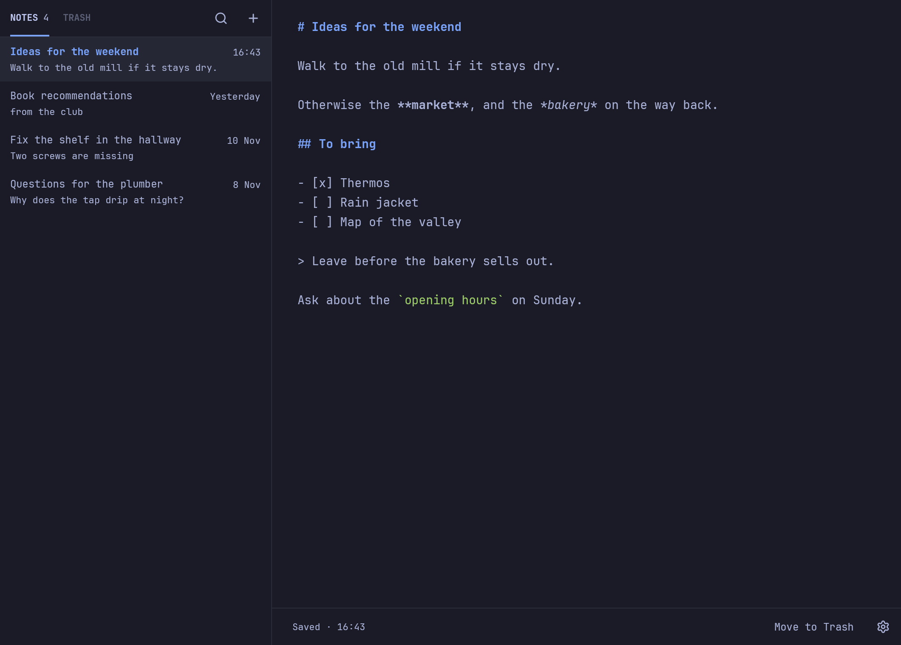

# Brouyon in detail

The [README](README.md) covers what Brouyon is and how to install it. This page has the rest:
every shortcut, how finding and lists work, where your notes live, the settings file, and
how to work on the code.



## Shortcuts

| Key | Action |
|---|---|
| `Ctrl+N` | New note |
| `Ctrl+F` | Find a note |
| `Alt+↑` / `Alt+↓` | Previous / next note |
| `Ctrl+Enter` | Tick a task, or make the line one |
| `Ctrl+Shift+Backspace` | Move to Trash |
| `Ctrl+Shift+T` | Switch between the Notes and Trash tabs |
| `Esc` | Stop finding, leave the Trash, or close Settings |
| `Ctrl+Z` / `Ctrl+Shift+Z` | Undo / redo |
| `Ctrl+,` | Settings |
| `Ctrl+Plus`, `Ctrl+Minus`, `Ctrl+0` | Text size |
| `F1` or `Ctrl+/` | Show these shortcuts |
| `Ctrl+Q` | Quit |

## Finding a note

`Ctrl+F`, or the magnifying glass above the list, opens a field there. The list narrows
as you type to the notes that hold every word, anywhere in their text and in any case,
and each shows the line it was found on. Enter opens the first one, and `Alt+↓` and
`Alt+↑` walk through the rest. `Esc` lists every note again, and so does a new note.

In the Trash, the same field looks through the Trash.

## Lists

Start a line with `- `, `* `, `+ `, `1. ` or `- [ ] `, and Enter starts the next item:
the same bullet, the next number, or a task still to do. Enter on an item left empty
goes back a level, and at the first level it ends the list. `Shift+Enter` gives a plain
new line.

`Ctrl+Enter` ticks the task the cursor is on, or unticks it. On a line that isn't a
task, it makes it one. Code blocks are left as typed.

## Your notes

Notes live in `~/.local/share/brouyon/`, one file per note, named after the moment
it was created, such as `2026-11-06 09-42-15.md`. A note's title in the list is its
first line, the line under it is the next one with content, and its date is the file's
modified time.

The Trash is the `.trash` subfolder. Notes stay there until you delete them. Its tab
shows what you removed, and the Notes tab takes you back to the note you were on.

You can edit, add or remove these files with anything else. Brouyon picks up the
changes when its window next gets focus. Files that aren't valid UTF-8 are ignored
and left untouched. A note that you empty completely has its file removed.

## Settings

The gear at the bottom right, or `Ctrl+,`, opens a floating window for the theme, the
text size, the notes folder and the delay before a blank note. Moving to another folder
leaves existing notes where they are.

The Light and Dark themes only set the colours. Window transparency, the corners, the
font and the text size always follow the desktop, whichever theme you pick. Under
Omarchy's Glassy setting, Brouyon's background goes see-through like a terminal's while
its text stays solid, and dialogs stay opaque.

Brouyon saves your choices in `~/.config/brouyon/config.toml`, which you can also edit
by hand. Your comments are kept, and a file Brouyon can't read is reported rather than
replaced.

```toml
# omarchy follows the desktop's theme and its changes. Or light, or dark.
theme = "omarchy"

# Scales the desktop's text size, from 80 to 200.
text_percent = 100

# Minutes without activity before moving to a blank note. 0 turns this off.
idle_minutes = 5

# Where notes are stored. Without this line, ~/.local/share/brouyon.
notes_dir = "~/Notes"
```

## Development

```sh
bin/test
```

This runs the tests, then checks that `THIRD-PARTY-LICENSES.txt` still matches
`Cargo.lock`. After a dependency change, rewrite that file with `bin/licenses`.

Run the app on throwaway notes and settings, kept in `/tmp/brouyon-dev`, so it doesn't
touch your real ones. It still follows your real theme and transparency, which it only
reads:

```sh
bin/dev
```

To review every screen as an image, with no window on the desktop:

```sh
BROUYON_SCREENSHOTS=/tmp/brouyon-shots cargo test screenshots -- --ignored
```

This also checks that the see-through parts really are, and writes `readme.png`, the
picture at the top of this page (`screenshots/markdown-note.png`).
