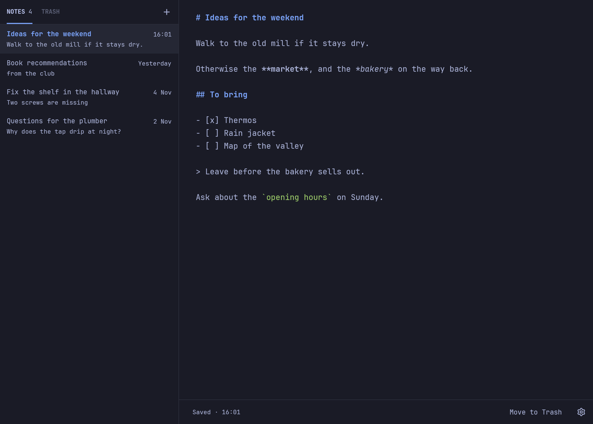

# Brouyon



A very simple markdown notepad for [Omarchy](https://omarchy.org), inspired by
[Drafts](https://getdrafts.com). It always opens on a blank note, ready to type.

- Notes save themselves as you type.
- After 5 minutes without activity, Brouyon saves and moves to a new blank note.
- Notes are listed on the left, with a tab for the Trash. There are no tags, folders
  or archive.
- Every note is a plain `.md` file. There is no database.
- It follows your Omarchy theme, font, text size and window transparency live.

## Install

Requires Rust (`mise.toml` pins the version) and the usual GPUI build
dependencies: clang, cmake, vulkan, wayland, libxkbcommon and fontconfig.

```sh
bin/install
```

This builds an Arch package and installs it with `makepkg`, so pacman asks for your
password. Brouyon then appears in the Omarchy launcher. Launching it again focuses the
window that's already open.

To open it from anywhere, add a key to `~/.config/hypr/bindings.lua`:

```lua
o.bind("SUPER + N", "Brouyon", "omarchy-launch-or-focus '^brouyon$' 'uwsm-app -- brouyon'")
```

## Shortcuts

| Key | Action |
|---|---|
| `Ctrl+N` | New note |
| `Alt+↑` / `Alt+↓` | Previous / next note |
| `Ctrl+Shift+Backspace` | Move to Trash |
| `Ctrl+Shift+T` | Switch between the Notes and Trash tabs |
| `Esc` | Leave the Trash, or close Settings |
| `Ctrl+Z` / `Ctrl+Shift+Z` | Undo / redo |
| `Ctrl+,` | Settings |
| `Ctrl+Plus`, `Ctrl+Minus`, `Ctrl+0` | Text size |
| `F1` or `Ctrl+/` | Show these shortcuts |
| `Ctrl+Q` | Quit |

## Your notes

Notes live in `~/.local/share/brouyon/`, one file per note, named after the moment
it was created, such as `2026-11-06 09-42-15.md`. A note's title in the list is its
first line, the line under it is the next one with content, and its date is the file's
modified time.

The Trash is the `.trash` subfolder. Notes stay there until you delete them. Its tab
shows what you removed, and the Notes tab takes you back to the note you were on.

You can edit, add or remove these files with anything else. Brouyon picks up the
changes when its window next gets focus. Files that aren't valid UTF-8 are ignored
and left untouched. A note that you empty completely has its file removed.

## Settings

The gear at the bottom right, or `Ctrl+,`, opens a floating window for the theme, the
text size, the notes folder and the delay before a blank note. Moving to another folder
leaves existing notes where they are.

The Light and Dark themes only set the colours. Window transparency, the font and the
text size always follow the desktop, whichever theme you pick. Under Omarchy's Glassy
setting, Brouyon's background goes see-through like a terminal's while its text stays
solid, and dialogs stay opaque.

Brouyon saves your choices in `~/.config/brouyon/config.toml`, which you can also edit
by hand. Your comments are kept, and a file Brouyon can't read is reported rather than
replaced.

```toml
# omarchy follows the desktop's theme and its changes. Or light, or dark.
theme = "omarchy"

# Scales the desktop's text size, from 80 to 200.
text_percent = 100

# Minutes without activity before moving to a blank note. 0 turns this off.
idle_minutes = 5

# Where notes are stored. Without this line, ~/.local/share/brouyon.
notes_dir = "~/Notes"
```

## Development

```sh
bin/test
```

Run the app on throwaway notes and settings, kept in `/tmp/brouyon-dev`, so it doesn't
touch your real ones. It still follows your real theme and transparency, which it only
reads:

```sh
bin/dev
```

To review every screen as an image, with no window on the desktop:

```sh
BROUYON_SCREENSHOTS=/tmp/brouyon-shots cargo test screenshots -- --ignored
```

This also checks that the see-through parts really are, and writes `readme.png`, the
picture at the top of this file (`docs/screenshot.png`).

## License

MIT. See [LICENSE](LICENSE).
