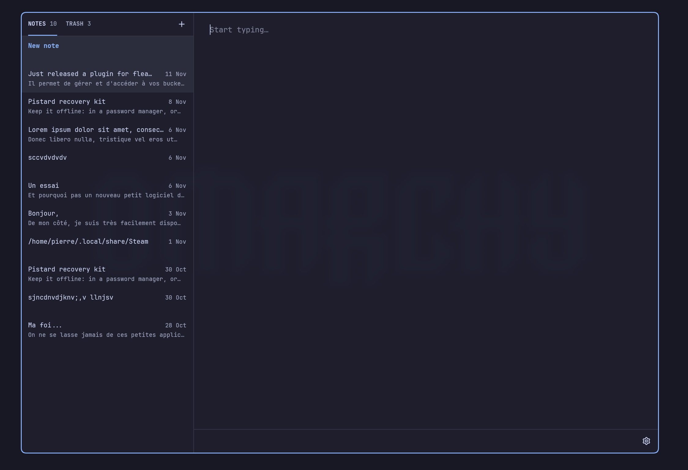
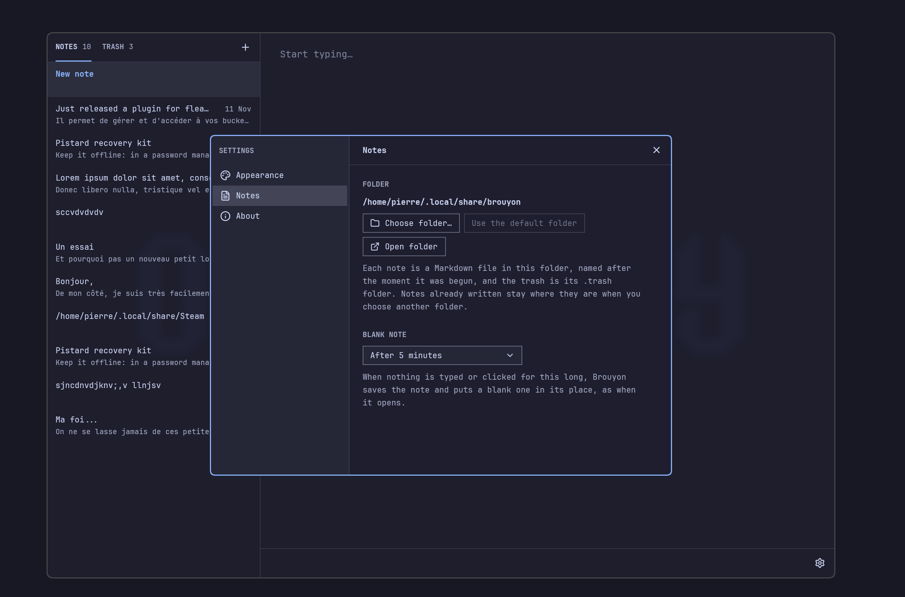

<a id="readme-top"></a>

<div align="center">

<pre>
─────────────────────────────
     B  R  O  U  Y  O  N

</pre>

# 📝 Brouyon

### *A blank page whenever you need one*

A small Markdown notepad for [Omarchy](https://omarchy.org), made for fast capture. Open it and type.<br/>

<br/>



<br/>

🎯 [Open it and type](#-open-it-and-type) • ✨ [Everything else](#-everything-else) • ⚡ [Installation](#-installation) • 🚀 [Getting started](#-getting-started) • 🎨 [Made for Omarchy](#-made-for-omarchy) • 💛 [Thanks](#-thanks) • 📜 [License](#-license)

</div>

---

## 🎯 Open it and type

That's the whole idea. Brouyon opens on a blank note with the cursor already in it, so the
first key you press is the first letter of your thought. There's no note to create, no file
to name and no folder to pick.

Leave it alone for 5 minutes and it puts you on a fresh blank note.

> **Brouyon is not a replacement for Obsidian, Notion and the like.** It has no links between
> notes, no tags, no folders and no plugins, and it isn't trying to grow them. It's for fast
> capture.

---

## ✨ Everything else

- 💾 **Nothing to save.** Notes save themselves as you type.
- ☑️ **Lists keep up.** Enter starts the next bullet, number or task, and `Ctrl+Enter` ticks a
  task.
- 🔍 **Find a note by the words in it.** `Ctrl+F` narrows the list as you type and shows the
  line each note matched on.
- 📄 **Plain files.** Every note is a `.md` file in `~/.local/share/brouyon/`. There is no
  database, and Brouyon picks up changes you make with other apps.

---

## ⚡ Installation

On Omarchy:

```bash
sudo pacman -S --needed base-devel git
git clone https://github.com/314r/brouyon.git
cd brouyon
mise install
mise exec -- bin/install
```

`mise install` fetches the Rust that `mise.toml` pins. `bin/install` builds an Arch package and
installs it with what it needs, so pacman asks for your password. The first build takes a few
minutes, and then Brouyon is in the Omarchy launcher. To update, `git pull` and run the last
line again. `sudo pacman -R brouyon` removes it and leaves your notes alone.

<div align="right"><a href="#readme-top">↑ back to top</a></div>

---

## 🚀 Getting started

1. **Open Brouyon** from the Omarchy launcher and start typing. Opening it again brings back
   the window that's already open.
2. **Give it a key**, so a blank note is one keystroke away. Add this line to
   `~/.config/hypr/bindings.lua`:
   ```lua
   o.bind("SUPER + N", "Brouyon", "omarchy-launch-or-focus '^brouyon$' 'uwsm-app -- brouyon'")
   ```
3. **Move between notes** with `Alt+↑` and `Alt+↓`, or click one. `Ctrl+N` starts a new one,
   and `F1` shows every shortcut.
4. **Change the settings** with the gear at the bottom right, or `Ctrl+,`: the theme, the text
   size, the notes folder and the delay before a blank note.



<details>
<summary>⌨️ Keyboard shortcuts</summary>

<br/>

| Shortcut | Action |
|---|---|
| `Ctrl+N` | New note |
| `Ctrl+F` | Find a note |
| `Alt+↑` / `Alt+↓` | Previous / next note |
| `Ctrl+Enter` | Tick a task, or make the line one |
| `Ctrl+Shift+Backspace` | Move to Trash |
| `Ctrl+Shift+T` | Switch between the Notes and Trash tabs |
| `Esc` | Stop finding, leave the Trash, or close Settings |
| `Ctrl+,` | Settings |
| `Ctrl+Plus`, `Ctrl+Minus`, `Ctrl+0` | Text size |
| `F1` or `Ctrl+/` | Show the shortcuts |

</details>

[DOC.md](DOC.md) explains how finding and lists work, how your files are named, the settings
file, and how to work on the code.

<div align="right"><a href="#readme-top">↑ back to top</a></div>

---

## 🎨 Made for Omarchy

Brouyon uses your Omarchy theme, monospace font, text size, window transparency and corners,
and follows changes to any of them while it's open. Under Omarchy's Glassy setting, its
background goes see-through like a terminal's while the text stays solid. If you'd rather
keep fixed colours, Settings also has a Light and a Dark theme.

<div align="right"><a href="#readme-top">↑ back to top</a></div>

---

## 💛 Thanks

- **[GPUI](https://www.gpui.rs)** by Zed Industries,
  **[gpui-kit](https://github.com/longbridge/gpui-kit)** by Longbridge and
  **[gpui-omarchy](https://github.com/huacnlee/gpui-omarchy)** by Jason Lee draw the window.
  Brouyon's folder watcher is adapted from gpui-omarchy's.
- **[Omarchy](https://omarchy.org)** set the look.
- **[Lucide](https://lucide.dev)** made the icons, and
  **[pulldown-cmark](https://github.com/pulldown-cmark/pulldown-cmark)** reads the Markdown.
- The script that writes [THIRD-PARTY-LICENSES.txt](THIRD-PARTY-LICENSES.txt) is adapted from
  [Flea](https://github.com/thisisgm/flea)'s.

<div align="right"><a href="#readme-top">↑ back to top</a></div>

---

## 📜 License

[MIT](LICENSE) © 2026 Pierre Svaert ([314r](https://github.com/314r)). Brouyon also uses the
components in [THIRD-PARTY-LICENSES.txt](THIRD-PARTY-LICENSES.txt), each under its own license.
The folder watcher in `src/desktop.rs` adapts gpui-omarchy's, whose MIT notice is in
[LICENSES](LICENSES), and `tools/third-party-licenses` adapts Flea's.

---

<div align="center">

📝 ✍️ 📝

### 💛 Drawn with GPUI, and coloured by your Omarchy theme.

</div>
